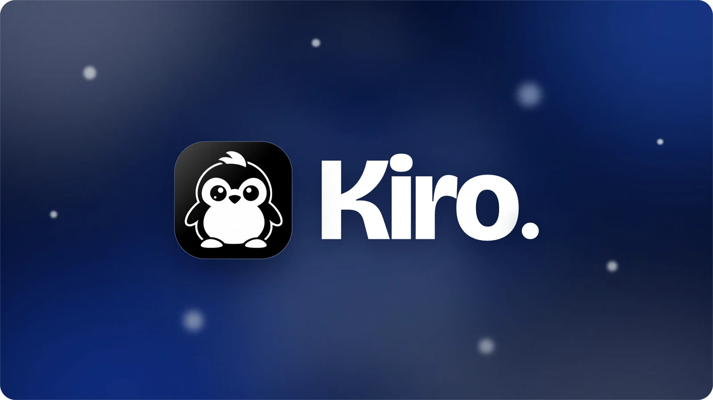
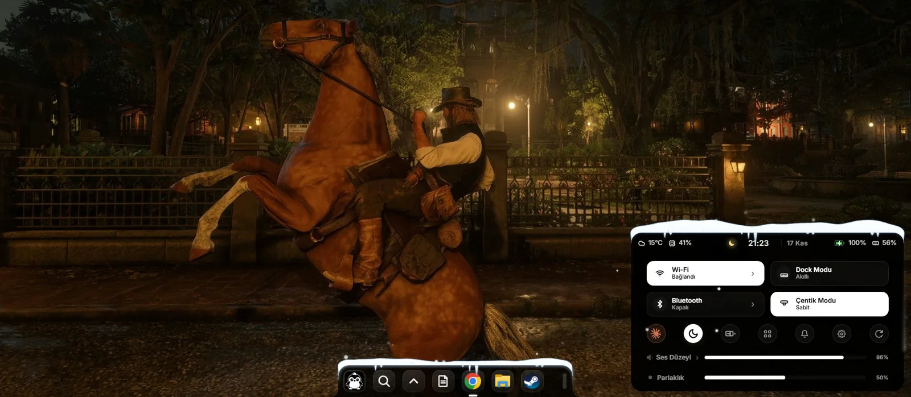
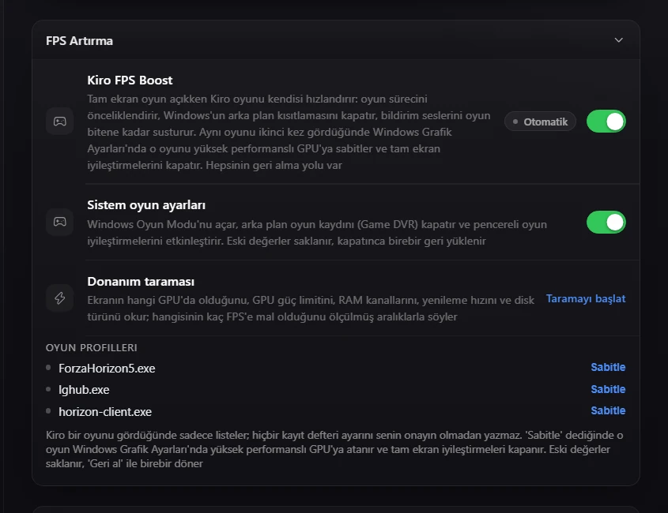
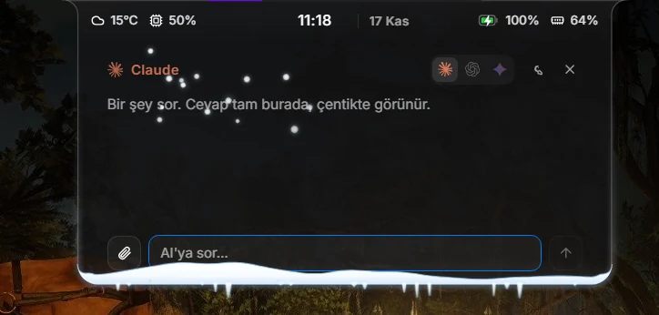
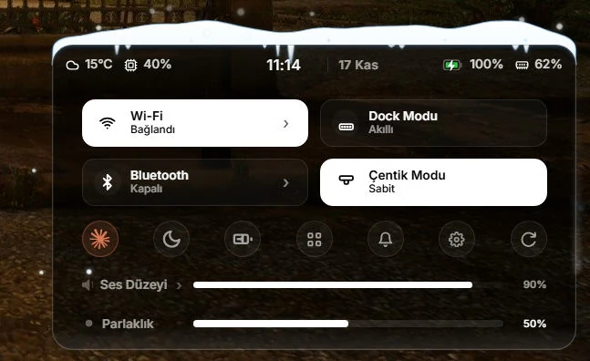
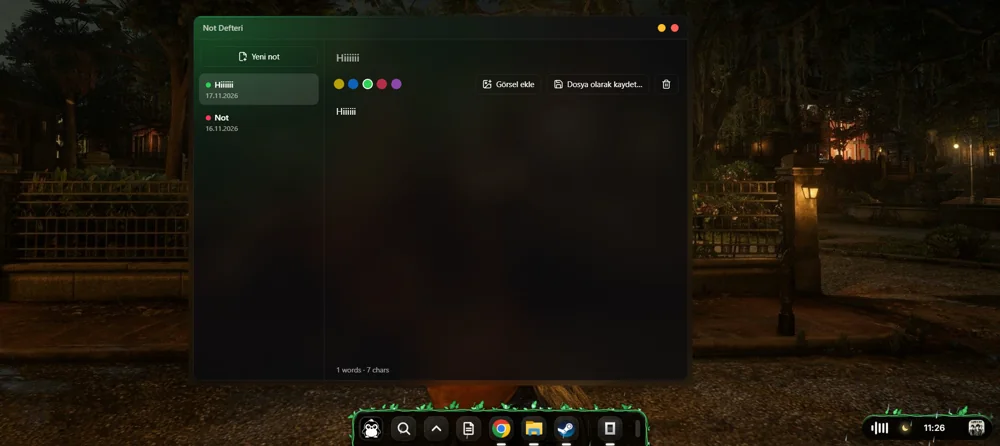
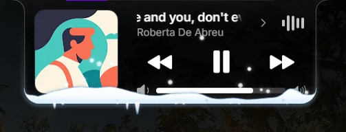
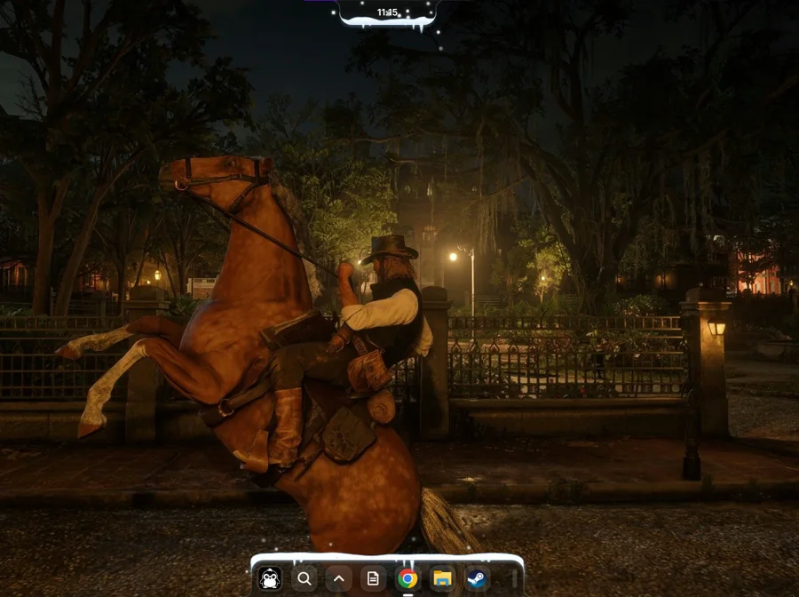
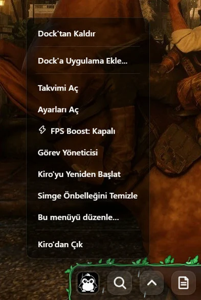
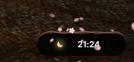

<div align="center">



<br />

### A notch, a dock and a performance layer for Windows.

It replaces your taskbar with a spring-animated notch and dock — then gets out of
the way the moment a game goes fullscreen.

<br />

[](https://github.com/fruyorsan/Kiro/releases/latest)

<br />

[](LICENSE)
[](https://www.microsoft.com/windows)

[**Download**](https://github.com/fruyorsan/Kiro/releases/latest) &nbsp;·&nbsp; [Features](#features) &nbsp;·&nbsp; [FPS Boost](#fps-boost) &nbsp;·&nbsp; [Screenshots](#screenshots) &nbsp;·&nbsp; [Install](#install) &nbsp;·&nbsp; [Settings](SETTINGS.md) &nbsp;·&nbsp; [Support](#support) &nbsp;·&nbsp; [Report a bug](https://github.com/fruyorsan/Kiro/issues/new/choose)

</div>



<div align="center"><sub>Winter on the notch rim and the dock edge — one of four seasons, each with its own rim decoration and falling particles. Go fullscreen and it all steps aside at the OS level, so the game keeps its direct-to-screen flip.</sub></div>

## Why Kiro

Windows gives you a taskbar and a notification area. Kiro gives you a desktop
that reacts: a notch that holds music, system controls, your calendar, notes and
a shelf; a dock that mirrors the apps you actually use; and a performance layer
that gets out of the way the moment a game goes fullscreen.

- **One place for the small stuff.** Music, Wi-Fi, Bluetooth, volume, brightness,
  battery, weather, calendar and timers live in the notch.
- **A dock that behaves like a dock.** Real icons, real window previews, pinned
  apps, running apps and notification dots, without the taskbar.
- **Frames when they matter.** Kiro stops its own work, hides its windows and
  boosts the game while you play, then puts everything back.
- **Yours.** Your logo, your accent colour, your layout, your monitor.

## FPS Boost

Kiro's FPS work is a capability, not a checklist you configure per game. It has
two halves: silent, self-reverting work while a game runs, and an honest hardware
audit that says what is actually costing frames.



| While a game is fullscreen | Why it matters |
| --- | --- |
| Raises the game process priority | Background work cannot preempt the render thread. |
| Clears Windows EcoQoS throttling for the game | Windows otherwise parks game threads on efficiency cores. |
| Raises the game's memory priority | Its pages stop being the first trim candidates mid-frame. |
| Mutes toast notifications | A toast is a new topmost window; DWM composites a frame over the game and that shows up in 1% lows. |
| Hides Kiro's own windows at the OS level | A visible topmost window steals the game's direct-to-screen flip path. |

None of it needs a reboot, none of it touches the game's files, and all of it is
reverted when the game exits or Kiro quits. Anti-cheat protected processes are
left alone: Kiro never injects a DLL and never opens the game's memory.

After Kiro has seen the same game twice, it can also route it to the
high-performance GPU and disable fullscreen optimizations for that executable,
with an **Undo** button for every profile. The hardware audit reports the real
bottleneck (GPU power limit, MUX/hybrid routing, Flex Mode RAM, refresh rate)
instead of promising frames it cannot deliver.

Read the full design in [docs/fps-boost.md](docs/fps-boost.md).

## AI in the notch

Open Control Center from the notch, press the AI button, and ask. Kiro supports
Claude, ChatGPT and Gemini, keeps the last working model warm, shows how long a
request has been running, and lets you stop it at any time. Attach a screenshot
or an image with the paperclip; the image is sent with the question.



Provider keys stay in your local settings and are only sent to the provider you
chose.

## Screenshots

<div align="center">


<br />
<sub><b>Control Center</b> — Wi-Fi, Bluetooth, sound and light in one card you arrange yourself.</sub>

<br />
<br />


<br />
<sub><b>Notes</b> — a small notebook with colours, pictures and export.</sub>

<br />
<br />


<br />
<sub><b>Music</b> — album art, playback controls and a live visualizer.</sub>

<br />
<br />


<br />
<sub><b>Autumn</b> — vines, leaves and a media card, over the game.</sub>

<br />
<br />


<br />
<sub><b>Dock menu</b> — pin, add an app, open Settings or toggle FPS Boost.</sub>

<br />
<br />


<br />
<sub><b>Blossom</b> — petals drifting over the notch.</sub>

</div>

## Features

| What you get | How it works |
| --- | --- |
| **A notch that does things** | Music, a Control Center you arrange yourself, status, a calendar and a file shelf in one spring-animated island. |
| **A dock that replaces your taskbar** | Mirrors your real taskbar, same pinned apps and order, with real icons and names, and a dot on apps that want your attention. |
| **Native where it counts** | The tray opens the real Windows flyout, and Quit ends an app like Task Manager's End task. |
| **Out of your way** | Fixed, Smart or Peek modes, and both stay hidden over fullscreen games. |
| **Made for your setup** | Every monitor, one monitor, or a specific one. Solid, glass or Material You styles with your own accent colour. English and Turkish. Every option lives in a plain `settings.json`. |
| **Light on the system** | Audio capture, cursor tracking and thumbnail work pause themselves when nothing needs them. Memory Saver hands unused RAM back to Windows. |
| **Ask AI from the notch** | Ask Claude, ChatGPT or Gemini a question, with screenshots attached. The panel shows elapsed time and can be stopped at any moment. |
| **Make it yours** | Pick your own picture for the Kiro mascot; it is cropped and scaled automatically and appears on the notch, dock, splash and settings at once. |
| **Notes with pictures** | A small notebook in the dock: name a note, give it a colour, attach up to six pictures and export it as text. Pictures are downscaled so the notebook stays light. |
| **Automatic Performance Mode** | When a fullscreen game or app is in front, Kiro stops capturing previews/icons, slows background polling, disables blur and animation work, stops trimming memory, and hides its always-on-top windows at the OS level so the game keeps direct-to-screen flip. Everything returns on exit. |

## Install

1. Download `Kiro-Setup-<version>.exe` from the [latest release](https://github.com/fruyorsan/Kiro/releases/latest).
2. Choose **Just me** or **All users**. An all-users install asks for administrator permission once.
3. Kiro starts with a short splash, then the notch and dock appear together.

Kiro updates itself: a green dot on the notch means an update is ready, and **Auto Update** in **Settings › About** installs it for you. Turn on **Get pre-releases** there to receive early builds before the weekly release. **Uninstall** from Windows Settings › Apps or from **Settings › About** puts your taskbar back.

> **Antivirus warnings:** the installer is not code-signed yet, so Windows SmartScreen and a few antivirus engines flag it. Kiro is open source, has no telemetry or tracking, and every installer is built by the release workflow in this repository. You can read every line, [build it yourself](#build-from-source), or drop the installer into [VirusTotal](https://www.virustotal.com/) before running it.

<details>
<summary><b>Why a couple of VirusTotal engines flag the installer</b></summary>

<br />

Kiro's installer is unsigned, and an unsigned installer that unpacks itself and writes to Program Files is exactly the shape heuristic engines look for. A release normally lands at around **2 detections out of ~70**, and it is almost always the same two machine-learning engines: **SecureAge** ("Malicious") and **Trapmine** ("Suspicious.low.ml.score"). Neither has a signature for the file; they score its structure and score it low.

This is not specific to Kiro. LibreWolf, ungoogled-chromium and other unsigned Windows builds collect the same verdicts, and they come back on every new build because VirusTotal scores files, not projects — each release gets a new hash and a new scan, so clearing one installer does not clear the next.

What actually fixes it is code signing, which is on the roadmap. Until then you can confirm a download three ways: check its hash against the release notes, run it through VirusTotal and read the per-engine details, or build Kiro from this repository in two commands.

</details>

<details>
<summary>Only download from this repository</summary>

<br />

Every installer is built by the release workflow in this repository and attached
to a [GitHub release](https://github.com/fruyorsan/Kiro/releases). Builds that
arrive from anywhere else are not ours. If you would rather not trust a binary
at all, [build it from source](#build-from-source) — it takes two commands.

</details>

## Usage

**Notch panels.** Scroll or swipe on the notch to change panel.

| Panel | What it does |
| --- | --- |
| **Music** | Album art, track info, playback controls, a visualizer, and a switch between several playing apps. |
| **Control Center** | Wi-Fi, Bluetooth, Do Not Disturb, volume and brightness. Drag tiles, buttons and sliders into your own layout. |
| **Status** | Battery (hidden on desktops without one) and weather, in a layout you choose. |
| **Calendar** | Day, week, month and agenda views, a timer, a stopwatch and Pomodoro. |
| **Shelf** | Drop files, text or a picture from your browser and drag them out later. |

**Visibility modes.** The notch and the dock each have their own.

| Mode | Behavior |
| --- | --- |
| **Fixed** | Always visible. The dock reserves screen space like a normal taskbar. |
| **Smart** | Hides when another window overlaps it and reveals on hover. |
| **Peek** | Hidden until the cursor reaches the screen edge, or a media event arrives. |

In Smart and Peek both stay hidden, and click-through, while a fullscreen app is in front.

**Multiple monitors.** Under **Show On**, pick **Primary Monitor** (the default), **All Monitors** or a **Specific Monitor** for the dock and the notch separately. Each extra monitor gets its own windows, so **All Monitors** uses more memory than a single display.

**Dock menu.** Right-click any icon to pin or unpin it, open a new instance, change its icon, or quit the app. Right-click the dock background to add an app, open Settings or Calendar, or restart Kiro. The menu is yours: **Settings › Dock › Right-click menu** turns any built-in entry on or off and lets you add shortcuts to your own apps and files. **Customize this menu…** at the bottom of the menu takes you straight there.

## Troubleshooting

<details>
<summary><b>The dock shows over my game</b></summary>

<br />

Kiro hides the dock and notch whenever a fullscreen game covers the whole monitor, in every dock mode. It does this natively (`ShowWindow`), not just by moving them off-screen, because a visible topmost window forces Windows to composite the game instead of letting it flip straight to the display. Only the monitor with the game is affected and everything comes back when you exit. Turn **Fullscreen Game Boost** off in Settings › General if you want the dock to stay visible. If something still appears, open an issue with the game and its display mode (fullscreen, borderless or windowed).

</details>

<details>
<summary><b>The Windows taskbar did not come back</b></summary>

<br />

Start Kiro again; it restores the taskbar on launch even after a crash. Uninstalling from Windows Settings › Apps or from **Settings › About** brings it back too.

</details>

<details>
<summary><b>Kiro uses a lot of memory</b></summary>

<br />

Every window runs in its own WebView2 process, so each monitor adds a notch and a dock. Set **Show On** to one monitor to cut it down. **Maximum Memory Saving** in Settings › General turns off GPU acceleration for another 140–170 MB.

</details>

<details>
<summary><b>Brightness does not change on my external monitor</b></summary>

<br />

External monitors are controlled over DDC/CI. Turn DDC/CI on in the monitor's own menu, and connect it directly if you use a dock or adapter, since some do not pass it on.

</details>

<details>
<summary><b>Something else is broken</b></summary>

<br />

Open **Settings › About › Copy Diagnostics** and paste the result into a [bug report](https://github.com/fruyorsan/Kiro/issues/new/choose). It includes your versions, monitors and recent log.

</details>

## Build from source

You need [Rust](https://rustup.rs/) and [Bun](https://bun.sh/) on Windows.

```bash
git clone https://github.com/fruyorsan/Kiro.git
cd Kiro
bun install
bun run tauri dev
```

`bun run tauri build` makes a release build. Before a pull request, read [CONTRIBUTING.md](CONTRIBUTING.md).

## Roadmap

These are ideas under consideration, not promises.

- [ ] Background tray programs (antivirus, VPN) in the notch
- [ ] Lower memory use, with Settings loaded on demand
- [ ] Code signing for the installer
- [x] Stable and pre-release update channels
- [x] Multiple media sessions, Task Manager in the dock menu, show desktop corner

See the [open issues](https://github.com/fruyorsan/Kiro/issues) for requests and known bugs.

## Built with

[](https://tauri.app/)
[](https://www.rust-lang.org/)
[](https://react.dev/)
[](https://www.typescriptlang.org/)
[](https://vitejs.dev/)

## Support

Kiro is free, open source and built in the open. If it makes your desktop nicer,
you can put something back into its development.

<p align="center">
  <a href="https://github.com/sponsors/fruyorsan"></a>
  <a href="https://buymeacoffee.com/fruyorsan"></a>
</p>

Sponsorships pay for a code-signing certificate, the machines that build and test
each release, and the hours that go into it. Nothing is locked behind them: every
feature ships to everyone, sponsored or not.

If you would rather help without money, a star, a bug report and a screenshot of
your setup help just as much.

## License

Kiro is open source under the [GPLv3](LICENSE). Third-party notices are listed in
[NOTICE.md](NOTICE.md). The Kiro name, logo and mascot are covered by the
[trademark policy](TRADEMARK.md) — fork the code freely, but ship your fork under
its own name.

<div align="center">
<br />
<sub>Built for Windows 10 and 11. No telemetry. No account. No taskbar.</sub>
</div>

